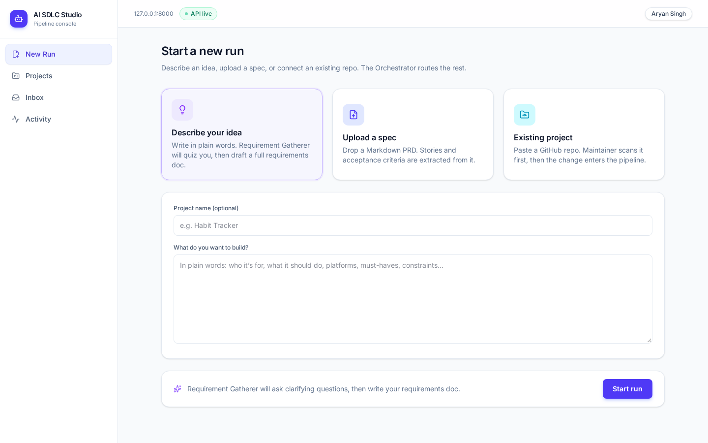
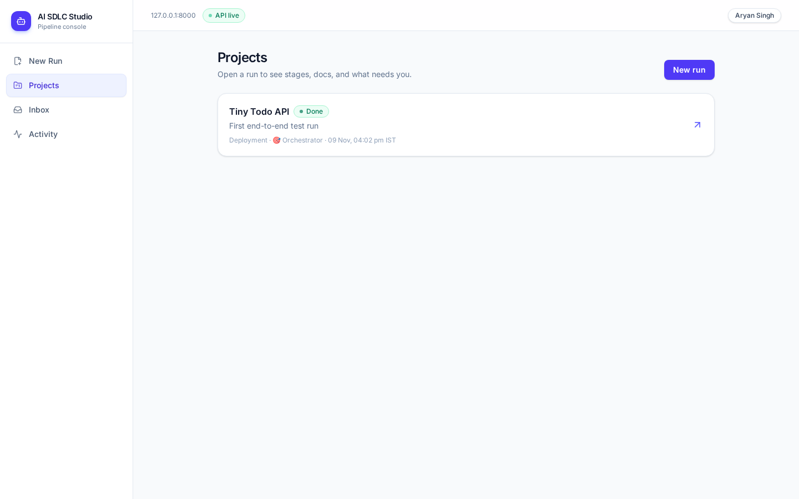
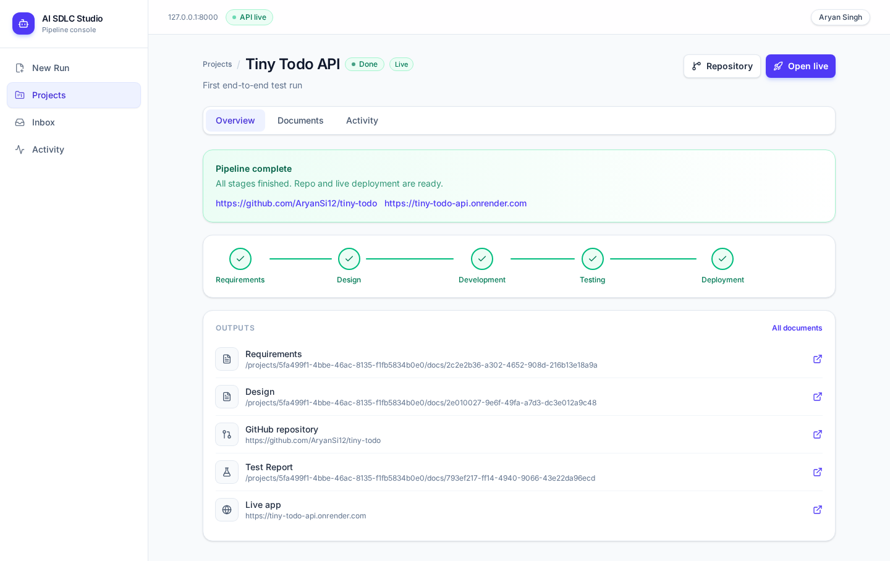
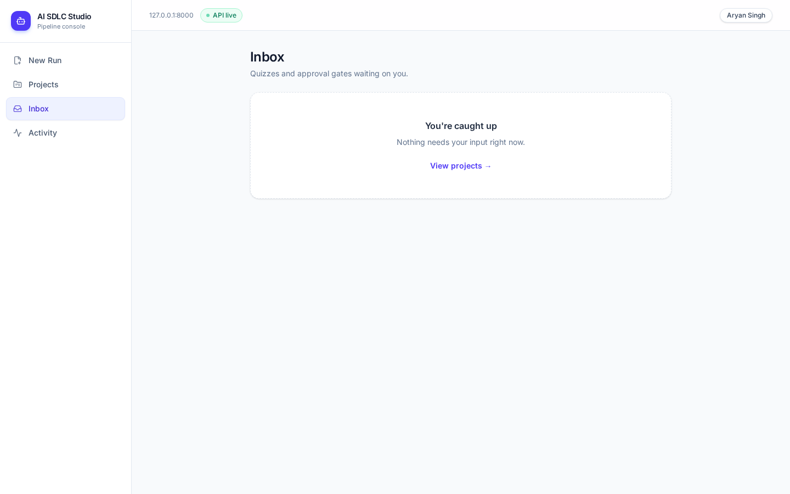

# AI SDLC Studio

Bot-based AI software development lifecycle governance console — FastAPI backend + React (Vite/Tailwind) UI.

## Quick start (Windows / macOS / Linux)

### Option A — scripts

**macOS / Linux**
```bash
./start.sh
```

**Windows (PowerShell)**
```powershell
.\start.ps1
```

**Windows (CMD)**
```bat
start.bat
```

Then open http://127.0.0.1:5173  
API health: http://127.0.0.1:8000/health

### Option B — Docker Compose

```bash
docker compose up --build
```

Frontend: http://localhost:5173 · Backend: http://localhost:8000

### Option C — manual

```bash
# backend
cd backend
python3 -m venv .venv && source .venv/bin/activate   # Windows: .venv\Scripts\activate
pip install -r requirements.txt
cp .env.example .env
python seed.py
# optional: restore Tiny Todo demo
python scripts/import_data.py ../data/tiny-todo-export.json
uvicorn app.main:app --host 127.0.0.1 --port 8000

# frontend (new terminal)
cd frontend
npm install
echo "VITE_API_URL=http://127.0.0.1:8000" > .env
npm run dev
```

## Export / import data

```bash
cd backend
python scripts/export_data.py --project-id <uuid> -o ../data/my-export.json
python scripts/import_data.py ../data/my-export.json
```

## Exposing the backend to bots (tunnel)

If bots run on another machine/cloud agent, expose local port 8000:

```bash
cloudflared tunnel --url http://localhost:8000
```

Copy the `https://….trycloudflare.com` URL into `bots/config.json`:

```json
{
  "api_base": "https://YOUR-TUNNEL.trycloudflare.com",
  "bot_token": "dev-bot-token-change-me"
}
```

Or set env: `SDLC_API_BASE` / `SDLC_BOT_TOKEN`.

Bot contract + CLI: see [`bots/README.md`](bots/README.md).

## Tests

```bash
cd backend && source .venv/bin/activate && pytest -q
cd frontend && npm run build
```

## Env

| Variable | Where | Purpose |
|----------|-------|---------|
| `DATABASE_URL` | backend | SQLite or Postgres URL |
| `BOT_TOKEN` | backend | Shared secret for `X-Bot-Token` |
| `CORS_ORIGINS` | backend | Comma-separated origins, or `*` |
| `HOST` / `PORT` | backend | Bind address |
| `VITE_API_URL` | frontend | API base URL baked into the UI |


## Screenshots






## Hosted (Render)

`render.yaml` deploys a Python web service (serves API + built UI from `backend/static`) and a free Postgres database. Free Postgres on Render expires after 30 days unless upgraded.


## Frontend on Vercel (Phase 2)

Root directory: `frontend`. Framework preset: Vite.

Environment (Production + Preview):

```
VITE_API_URL=https://ai-sdlc-studio.onrender.com
```

`frontend/vercel.json` rewrites all routes to `index.html` for the SPA.

The Render backend already allows CORS via `CORS_ORIGINS=*` (or explicit origins + `https://*.vercel.app` / regex). Same-origin static under `backend/static` stays supported when `VITE_API_URL` is empty.
